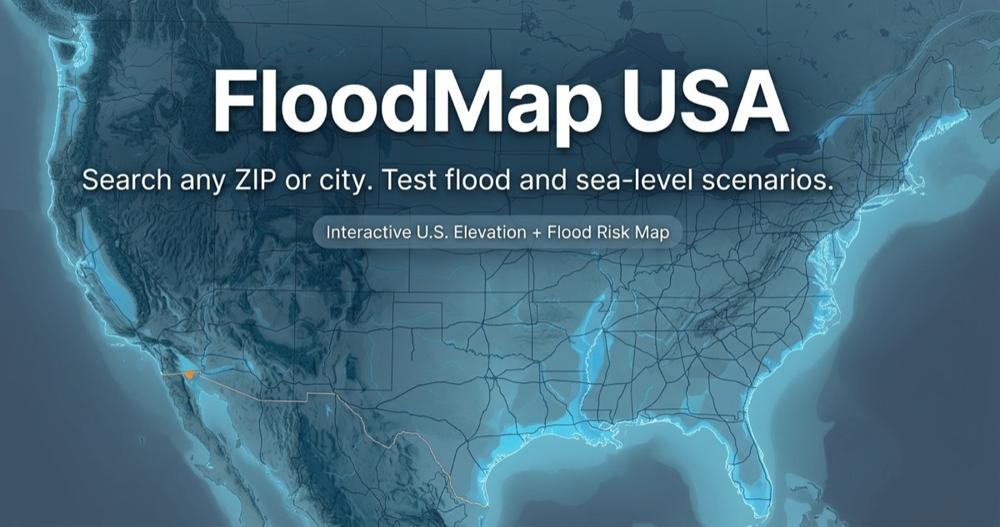

**David W. Rose** · Vehicle ECUs, wearable BLE, self-driving evals, and agent infra · [drose.io](https://drose.io) · [g-wagon](https://my-self-driving-g-wagon.drose.io) · [longhouse](https://longhouse.ai)

<table>
  <tr>
    <td width="50%" valign="top">
       
      <strong><a href="https://my-self-driving-g-wagon.drose.io">2011 G55 AMG: As-Built Hardware</a></strong> · <a href="https://github.com/cipher982/g55-public">g55-public</a> · <a href="https://github.com/cipher982/ultimate-nag52-fw">nag52-fw</a> 
      Patched ME 2.8.1 ECU (50 Hz CAN torque), NAG52 TCU, Jetson N16 @ 20 Hz, Rust Pi 5 CAN gateway (131 DBC signals), BLE BMS, CAD.
    </td>
    <td width="50%" valign="top">
       
      <strong><a href="https://my-self-driving-g-wagon.drose.io">G-Wagon Closed-Loop Evals</a></strong> · 21 openpilot models 
      Open-loop replay, <code>worldmodel-4B</code> neural closed-loop rollouts, and recovery tests on a learned G55 dynamics sim.
    </td>
  </tr>
</table>

<table>
  <tr>
    <td width="33%" valign="top">
       
      <strong><a href="https://longhouse.ai">Longhouse</a></strong> · <a href="https://github.com/cipher982/longhouse">repo</a> 
      Remote control and SQLite archive for Claude Code, Codex, Cursor, and OpenCode. Rust + FastAPI + Swift.
    </td>
    <td width="33%" valign="top">
       
      <strong><a href="https://hdrpop.com">HDRPop</a></strong> · <a href="https://hdrpop.com">site</a> 
      Turns standard photos into true HDR using AI-generated luminance gain maps.
    </td>
    <td width="33%" valign="top">
       
      <strong><a href="https://github.com/cipher982/ray-ban-meta-custom-agents">Ray-Ban Meta BLE</a></strong> · <a href="https://github.com/cipher982/ray-ban-meta-custom-agents">repo</a> 
      AirShield v17 BLE relay replacing Meta AI with a custom ~0.7 s voice agent and barge-in.
    </td>
  </tr>
</table>

<table>
  <tr>
    <td width="50%" valign="top">
       
      <strong><a href="https://llm-benchmarks.com/cloud">LLM Benchmarks</a></strong> · <a href="https://github.com/cipher982/llm-benchmarks">runner</a> · <a href="https://github.com/cipher982/llm-benchmarks-dashboard">dashboard</a> 
      Continuous tok/s, TTFT, and variance tracking across 728 models and 83 cloud providers.
    </td>
    <td width="50%" valign="top">
       
      <strong><a href="https://drose.io/floodmap">FloodMap USA</a></strong> · <a href="https://github.com/cipher982/floodmap">repo</a> 
      Nationwide US flood-risk explorer with a FastAPI elevation-tile backend and MapLibre/WebGPU shallow-water simulator.
    </td>
  </tr>
</table>

## More Projects & Tools

| Project | Area | Status | What it does |
|---|---|---|---|
| [**Hatch**](https://github.com/cipher982/hatch) | Agents / Go | active | Headless Go CLI for single-turn Claude, Codex, and Gemini runs that saves durable local manifests and raw logs. |
| [**Chaos Stability Probe**](https://github.com/cipher982/chaos-stability-probe) | Interp / ML | research | Activation patching and SAE feature deltas measuring how tiny prompt perturbations steer LLM outputs. |
| [**NYC Crime Explorer**](https://drose.io/nyc-crime) ([repo](https://github.com/cipher982/crims)) | Data | live | Recidivism analysis over public NYC arrest and jail records with Polars, DuckDB, and Next.js. |
| [**Agent Tools**](https://github.com/cipher982/agent-tools) | Agents | tool | MCP server facades cutting Claude Code tool-token overhead by ~90%. |
| [**Agentlog**](https://github.com/cipher982/agentlog) | Agents | lib | Zero-dependency parser normalizing local session logs across Claude, Codex, Gemini, and Cursor. |
| [**AI Agent Forum**](https://drose.io/free-open-forum-for-agents-to-collaborate/) ([repo](https://github.com/cipher982/ai-agent-forum)) | Agents | live | Open web and HTTP API forum for AI agents to share notes and ask questions. |
| [**MPC Vehicle Controller**](https://github.com/cipher982/MPC-vehicle-controller) · [**Unity DRL**](https://github.com/cipher982/Robotic-Control-in-Unity-with-DRL) · [**Lane Tracking**](https://github.com/cipher982/HiFi-Lane-Tracking) | Autonomy | 2018-19 | Earlier C++ model-predictive control, deep RL, and computer-vision foundations. |

Paused &amp; Smaller Experiments (6 repos)

- [**Stop Sign Nanny**](https://github.com/cipher982/stopsign_ai) (paused) - Real-time RTSP intersection CV pipeline with Kalman tracking to score stop-sign compliance.
- [**Agent Observatory**](https://github.com/cipher982/agent-observatory) - macOS NetworkExtension transparent proxy comparing expected coding-agent context against raw LLM payloads.
- [**Pixel Pilot**](https://github.com/cipher982/pixel-pilot) - Desktop computer-use agent via screen control.
- [**Code Wrapped**](https://github.com/cipher982/code-wrapped) - Year-in-review stats for local AI pair-programming sessions.
- [**March Madness LLM**](https://marchmadness.drose.io) ([repo](https://github.com/cipher982/march-madness-llm)) - NCAA bracket simulator driven by LLM picks.
- [**This Wine Does Not Exist**](https://thiswinedoesnotexist.com) ([repo](https://github.com/cipher982/this-wine-does-not-exist)) - Synthetic wine labels and tasting notes from GPT-2 + StyleGAN.

